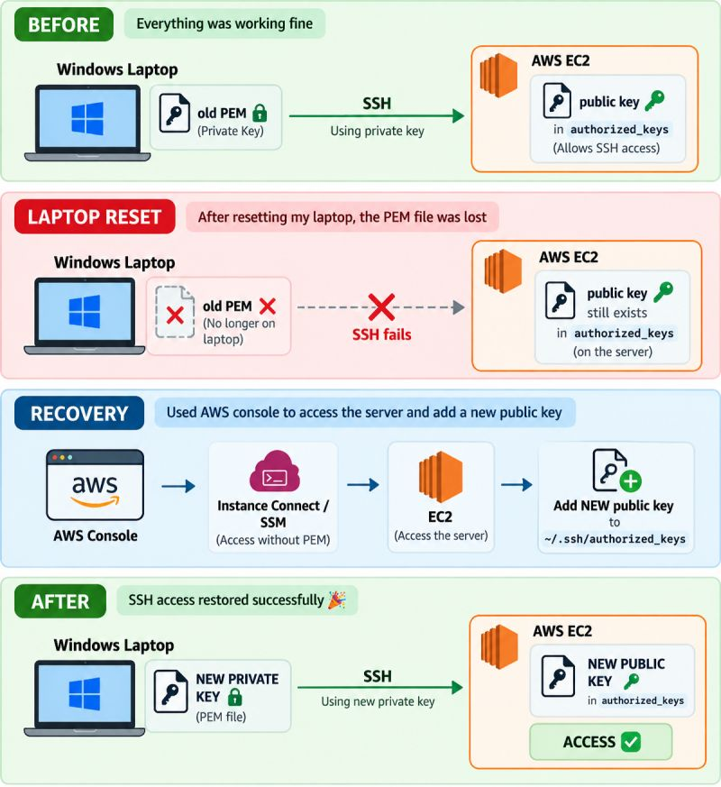

# 🔐 Recovering SSH Access to an AWS EC2 Instance After Losing the Private Key


A real-world troubleshooting write-up: after resetting my Windows laptop, the `.pem` private key I used to SSH into a production EC2 instance was gone. This repo documents **what happened, how I restored access without rebuilding the server, and what I learned about how SSH key authentication actually works.**



---

## 📌 The Problem

| | |
|---|---|
| **Environment** | AWS EC2 (Ubuntu), client: Windows laptop |
| **Trigger** | Laptop reset — local `.pem` private key lost |
| **Symptom** | `ssh -i key.pem ubuntu@<server-ip>` impossible — no key file |
| **First question** | *"If the PEM file is gone locally, is the server affected too?"* |

**Short answer: No.** The server never had the private key. It only holds the **public key** in `~/.ssh/authorized_keys`, and that file was untouched.

---

## 🔑 How SSH Key Authentication Works

```
 Windows laptop                                  EC2 instance
 ┌──────────────────────┐                        ┌───────────────────────────────┐
 │ private key (.pem) 🔐│ ── proves ownership ──▶│ ~/.ssh/authorized_keys        │
 │ never leaves laptop  │    (signature, not     │   contains matching public 🔑 │
 └──────────────────────┘     the key itself)    └───────────────────────────────┘
```

1. The client offers a public key and signs a challenge with the **private key**.
2. The server checks the signature against the **public keys** listed in `authorized_keys`.
3. Match → access granted. **The private key is never sent to or stored on the server.**

That's why AWS can't "re-download" your key: AWS only gives you the private key **once**, at key-pair creation time.

---

## 🛠️ How I Recovered Access

Because I still had an alternative way into the instance (no `.pem` needed), I didn't need to rebuild anything.

### 1. Generate a new key pair — on the **local machine**

```powershell
# Windows PowerShell (OpenSSH is built into Windows 10/11)
ssh-keygen -t ed25519 -C "aditi-laptop" -f $env:USERPROFILE\.ssh\ec2-new-key
```

This creates:
- `ec2-new-key` → **private key** (stays on the laptop, never shared)
- `ec2-new-key.pub` → **public key** (safe to copy to the server)

### 2. Get into the server without the old key

Via the AWS Console, using one of:
- **EC2 Instance Connect** — browser-based SSH; AWS pushes a temporary key (valid ~60 seconds)
- **Systems Manager Session Manager** — shell access with no open port 22 and no key at all

### 3. Add the new public key on the server

```bash
# Paste the contents of ec2-new-key.pub
echo "ssh-ed25519 AAAA... aditi-laptop" >> ~/.ssh/authorized_keys

# Permissions matter — SSH refuses keys with loose permissions
chmod 700 ~/.ssh
chmod 600 ~/.ssh/authorized_keys
```

### 4. Test **from the local Windows machine**

```powershell
ssh -i $env:USERPROFILE\.ssh\ec2-new-key ubuntu@<server-ip>
```

✅ **SSH access restored.**

### 5. Clean up

Remove the old, now-orphaned public key line from `authorized_keys` so a lost key can never be used again, and back up the new private key somewhere safe (e.g., a password manager).

---

## 💡 The Mistake I Made (and What It Taught Me)

After getting in through the console, I ran my SSH test **from inside the server**:

```text
ubuntu@ip-172-xx-xx-xx:~$ ssh -i C:\Users\...\ec2-new-key ubuntu@<server-ip>
Warning: Identity file ... not accessible: No such file or directory.
```

The prompt `ubuntu@ip-...:~$` was the clue — **I was already on the server.** My Windows key path doesn't exist on a Linux box. SSH tests must run from the **client** that holds the private key.

> **Lesson:** always read your prompt. `PS C:\Users\...>` = local Windows. `ubuntu@ip-...:~$` = remote server.

---

## 🧭 Recovery Options at a Glance

| Situation | Option | Requirements |
|---|---|---|
| Have console access | **EC2 Instance Connect** | `ec2-instance-connect` package (preinstalled on Ubuntu & Amazon Linux AMIs), port 22 open to the Instance Connect IP range |
| Agent configured | **SSM Session Manager** | SSM Agent running + instance IAM role with `AmazonSSMManagedInstanceCore` |
| Neither works | **EC2 Serial Console** | Nitro instance, serial console enabled, a password-enabled OS user |
| Fully locked out | **Detach & fix root volume** | Stop instance → attach volume to a helper instance → edit `authorized_keys` → reattach |

---

## 📚 Key Takeaways

- Losing a local private key **does not** remove the public key from the server.
- The server stores the **public** key; the **private** key exists only on your machine.
- AWS **cannot** re-issue a lost private key — you add a new public key instead.
- Always keep a **second access path** (SSM Session Manager is the cleanest).
- **Never commit private keys** to Git — see this repo's [`.gitignore`](.gitignore).
- Back up keys in a password manager; laptop resets happen.
- Don't just memorize `ssh -i key.pem user@server` — understand what it does.

---

## 📂 Repo Structure

```
aws-ec2-ssh-key-recovery/
├── README.md                     ← this write-up
├── docs/
│   └── ssh-cheatsheet.md         ← commands for Windows & Linux
├── assets/
│   └── ssh-recovery-flow.png     ← before / reset / recovery / after diagram
└── .gitignore                    ← blocks *.pem, private keys, AWS credentials
```

---

## 🏷️ Skills Demonstrated

`AWS EC2` · `IAM & SSM` · `SSH / Public-key cryptography` · `Linux administration` · `Windows OpenSSH` · `Incident troubleshooting` · `Technical documentation`

---

**Author:** [Aditi Kalamkar](https://github.com/aditikalamkar) · [LinkedIn](https://www.linkedin.com/in/aditi-kalamkar-638b2a261)
